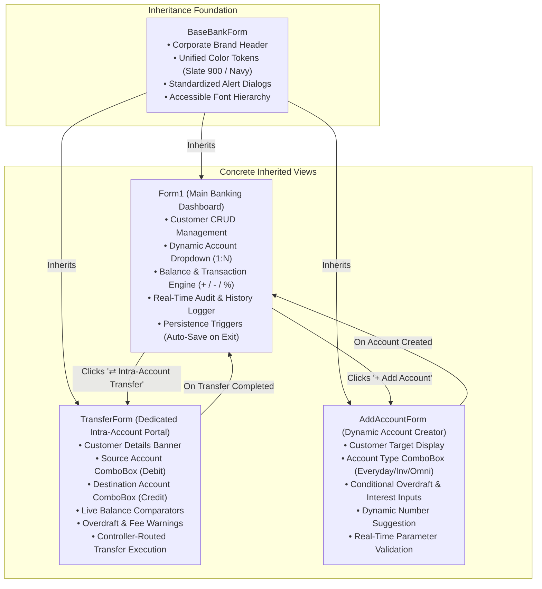

# Task 4: UI Navigation Flow, Sitemap & Form Inheritance Wireframes

**Project:** Nova Premier Bank — Sprint 3 (Data Persistence & Final Delivery)  
**Student Name:** Muskan Panwar  
**Student ID:** 20240040  
**Course:** IT7742 - Assessment 3  
**Institution:** Whitecliffe College of Technology & Innovation  

---

## 1. System Navigation Flow & Sitemap

The application architecture utilizes **Visual and Structural Form Inheritance** to establish a uniform, accessible, and branded desktop experience. All screens inherit corporate typography (Segoe UI), color styling (Slate 900 navy headers, Slate 100 canvas), and standardized notification dialogs from `BaseBankForm`.



---

## 2. High-Fidelity ASCII Wireframes

### 2.1 Main Banking Dashboard (`Form1 : BaseBankForm`)

```
+========================================================================================================+
|  NOVA PREMIER BANK                                              Active: Muskan Panwar (20240040)       |
|  Sprint 3: JSON Persistence | Form Inheritance | Intra-Account Transfers     [Role: Regular Customer]  |
+========================================================================================================+
| [ Left Column: Customer & Account Controls ]                 | [ Right Column: Audit Logging ]         |
| +----------------------------------------------------------+ | +-------------------------------------+ |
| | Customer Management (MVC Controller)                     | | | Activity & Audit Log (Persistence)  | |
| | Select Customer: [ 20240040 - Muskan Panwar [Regular] v] | | | [11:15:02] === System Started ===   | |
| | Customer ID: [ 20240040 ]    Name: [ Muskan Panwar     ] | | | [11:15:02] [PERSISTENCE] State    | |
| | Contact:     [ muskan.panwar@email.com                 ] | | |            loaded from bank_data    | |
| | [ ] Staff (50% Fee Discount)                             | | | [11:15:10] [INTRA-TRANSFER]        | |
| | [ Add Customer ] [ Update Details ] [ Delete ] [ Reset ] | | |            ED-20240040 -> INV-20240040|
| | Status: Viewing record for Muskan Panwar (3 Accounts).   | | |            +$200.00 Approved.       | |
| +----------------------------------------------------------+ | |                                     | |
|                                                              | |                                     | |
| +----------------------------------------------------------+ | |                                     | |
| | Account Overview & Allocation                            | | |                                     | |
| | Select Account: [ ED-20240040 (Everyday) v ] [+ Add Acc] | | |                                     | |
| | Account No: ED-20240040                                  | | |                                     | |
| | CURRENT BALANCE:  $500.00                                | | |                                     | |
| | Rules: No Interest | No Overdraft | $0 Transaction Fee   | | |                                     | |
| +----------------------------------------------------------+ | |                                     | |
|                                                              | |                                     | |
| +----------------------------------------------------------+ | |                                     | |
| | Financial Operations & Intra-Account Transfers           | | |                                     | |
| | Amount ($): [ 100.00 ]   [ + Deposit ]   [ - Withdraw ]  | | |                                     | |
| | [ % Apply Interest ]     [ ⇄ Intra-Account Transfer... ] | | |                                     | |
| | Status: Ready for transactions.                          | | | [💾 Save JSON] [📂 Load] [Clear Log]| |
| +----------------------------------------------------------+ | +-------------------------------------+ |
+========================================================================================================+
```

---

### 2.2 Dedicated Intra-Account Transfer Portal (`TransferForm : BaseBankForm`)

```
+===================================================================================+
|  NOVA PREMIER BANK                                                                |
|  Intra-Account Transfer — Move funds between accounts owned by this customer      |
+===================================================================================+
| Active Customer: Muskan Panwar (ID: 20240040)         Role: Regular Customer      |
+-----------------------------------------------------------------------------------+
|  Transfer Details (Intra-Account Only)                                            |
|                                                                                   |
|  Source Account (Debit):                                                          |
|  [ ED-20240040 (Everyday) - $500.00                                   v ]         |
|  Available: $500.00                                                               |
|                                                                                   |
|  Destination Account (Credit):                                                    |
|  [ INV-20240040 (Investment) - $2000.00                               v ]         |
|  Available: $2000.00                                                              |
|                                                                                   |
|  Transfer Amount ($): [ 200.00    ]                                               |
|                                                                                   |
|  [i] Transfers between different customers are strictly prohibited.               |
|      Overdraft limits and failed fees apply to source accounts.                   |
|                                                                                   |
|                                        [ ⇄ Execute Transfer ]   [ Cancel / Close ]|
+===================================================================================+
```

---

### 2.3 Dynamic Account Creator (`AddAccountForm : BaseBankForm`)

```
+===================================================================================+
|  NOVA PREMIER BANK                                                                |
|  Add New Account — Assign an additional account to Muskan Panwar                  |
+===================================================================================+
|  Account Specification                                                            |
|                                                                                   |
|  Account Type:                     Account Number:                                |
|  [ Investment Account          v ] [ INV-20240040-04                 ]            |
|                                                                                   |
|  Initial Deposit ($):              Interest Rate (%):                             |
|  [ 1500.00                       ] [ 4.75                            ]            |
|                                                                                   |
|  Overdraft Limit ($):                                                             |
|  [ 0.00                          ] (Disabled for Investment)                      |
|                                                                                   |
|  [i] Investment Account: Accrues compound interest on balance. Failed transactions|
|      incur a $10 fee ($5 for bank staff). No overdraft.                           |
|                                                                                   |
|                                            [ + Open Account ]   [ Cancel ]        |
+===================================================================================+
```
