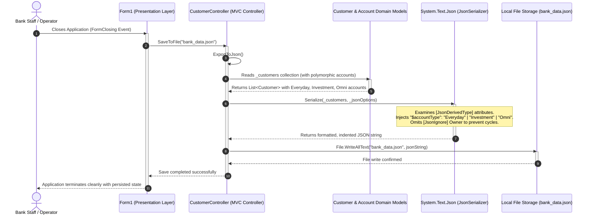
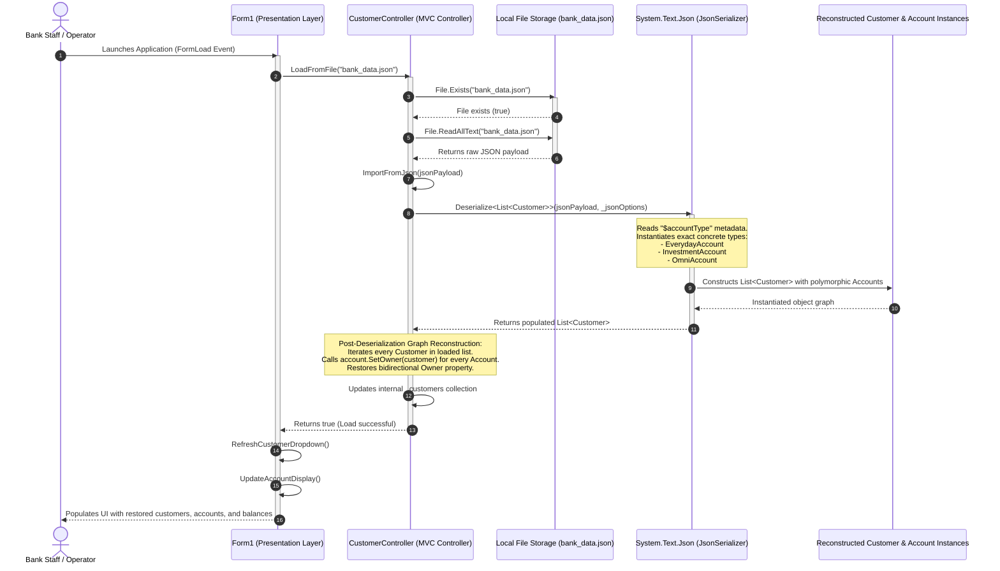

# Task 5: JSON Persistence Flow & Sequence Diagram

**Project:** Nova Premier Bank — Sprint 3 (Data Persistence & Final Delivery)  
**Student Name:** Muskan Panwar  
**Student ID:** 20240040  
**Course:** IT7742 - Assessment 3  
**Institution:** Whitecliffe College of Technology & Innovation  

---

## 1. Persistence Architecture Overview

Nova Premier Bank implements modern, standardized **JSON Data Persistence** utilizing the .NET `System.Text.Json` namespace. The system guarantees that all customer profile states, polymorphic account classifications (`EverydayAccount`, `InvestmentAccount`, `OmniAccount`), balances, and transaction rules are preserved across application executions.

### Key Architectural Standards:
1. **Polymorphic Type Discrimination**: The abstract base class `Account` is decorated with `[JsonPolymorphic(TypeDiscriminatorPropertyName = "$accountType")]` and `[JsonDerivedType]` attributes. During serialization, an explicit `$accountType` discriminator string is embedded, enabling exact type recreation upon deserialization.
2. **Cycle Prevention & Aggregate Root Encapsulation**: `Customer` serves as the aggregate root holding `List<Account>`. To prevent circular graph references during serialization, `Account.Owner` is decorated with `[JsonIgnore]`.
3. **Graph Reconstruction**: Upon loading, `CustomerController.ImportFromJson()` iterates through each reconstructed customer and invokes `account.SetOwner(customer)` to restore full bidirectional domain object references.
4. **Automated Lifecycle Integration**:
   - `Form1_Load` automatically triggers `_controller.LoadFromFile()` on application startup.
   - `Form1_FormClosing` automatically triggers `_controller.SaveToFile()` on application exit.

---

## 2. Sequence Diagram: Data Flow During Save (FormClosing)

The following sequence diagram illustrates the serialization process executed automatically when the banking application closes or when the operator clicks **Save JSON**:



---

## 3. Sequence Diagram: Data Flow During Load (FormLoad)

The following sequence diagram illustrates the deserialization and graph reconstruction process executed automatically on startup:



---

## 4. Sample Serialized JSON Data Structure

Below is an excerpt from the generated `bank_data.json` demonstrating polymorphic type discriminators and account separation:

```json
[
  {
    "CustomerNumber": "20240040",
    "Name": "Muskan Panwar",
    "ContactDetails": "muskan.panwar@email.com",
    "IsStaff": false,
    "Accounts": [
      {
        "$accountType": "Everyday",
        "AccountNumber": "ED-20240040",
        "Balance": 300.00,
        "LastTransactionStatus": "Transfer Out Successful: $200.00 to INV-20240040"
      },
      {
        "$accountType": "Investment",
        "InterestRate": 4.0,
        "FailedFee": 10.00,
        "AccountNumber": "INV-20240040",
        "Balance": 2200.00,
        "LastTransactionStatus": "Transfer In Successful: $200.00 from ED-20240040"
      },
      {
        "$accountType": "Omni",
        "InterestRate": 5.0,
        "OverdraftLimit": 500.00,
        "FailedFee": 10.00,
        "AccountNumber": "OMN-20240040",
        "Balance": 1500.00,
        "LastTransactionStatus": "Account opened."
      }
    ]
  },
  {
    "CustomerNumber": "STAFF01",
    "Name": "Rakshika",
    "ContactDetails": "rakshika@bank.com",
    "IsStaff": true,
    "Accounts": [
      {
        "$accountType": "Everyday",
        "AccountNumber": "ED-STAFF01",
        "Balance": 500.00,
        "LastTransactionStatus": "Account opened."
      },
      {
        "$accountType": "Investment",
        "InterestRate": 4.0,
        "FailedFee": 10.00,
        "AccountNumber": "INV-STAFF01",
        "Balance": 2000.00,
        "LastTransactionStatus": "Account opened."
      },
      {
        "$accountType": "Omni",
        "InterestRate": 5.0,
        "OverdraftLimit": 500.00,
        "FailedFee": 10.00,
        "AccountNumber": "OMN-STAFF01",
        "Balance": 1500.00,
        "LastTransactionStatus": "Account opened."
      }
    ]
  }
]
```
